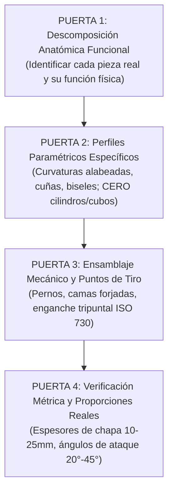

# Guía de Fidelidad Morfológica y Descomposición Anatómica 3D

> **Principio Fundamental:** Prohibición Total de Primitivas Absurdas como Placeholders.  
> **Caso de Referencia:** La Herejía del Cilindro frente a la Verdadera Vertedera para Campos Duros.

---

## 1. El Problema de la Pereza Morfológica en Modelado 3D

Cuando un agente recibe la tarea de modelar o generar proceduralmente un objeto mecánico, herramienta, vehículo o componente agrícola complejo (ejemplo: una *"vertedera para campos duros"*), suele cometer un error crítico:
**Sustituir la geometría funcional real por una primitiva genérica descontextualizada (un simple cilindro o un cubo estirado).**

Un cilindro carece por completo de:
- **Filo de corte y cuña de penetración:** Incapaz de cortar la solera del suelo.
- **Superficie alabeada de volteo:** Incapaz de levantar, fragmentar e invertir el prisma de tierra.
- **Guía longitudinal anti-empuje:** Incapaz de contrarrestar el par de fuerzas laterales de la tierra, desestabilizando cualquier simulación física.
- **Puntos de anclaje estructural:** Carente de cama forjada, timón y enganche tripuntal.

Entregar un cilindro por una vertedera es el equivalente a entregar un cubo plano cuando se pide una hélice de avión. Destruye la inmersión, inutiliza la simulación física y deshonra la fidelidad técnica.

---

## 2. El Protocolo de 4 Puertas Anatómicas (Anatomy-First Gate)

Antes de invocar cualquier herramienta MCP (`execute_blender_code`, importadores o scripts procedurales) para crear una malla 3D, el agente DEBE validar obligatoriamente las siguientes **4 Puertas Anatómicas**:



### Puerta 1: Descomposición Anatómica Funcional
- Ningún objeto complejo es un bloque monolítico. Todo elemento mecánico o arquitectónico se compone de sub-piezas especializadas.
- Se debe redactar una tabla de despiece con la función física de cada elemento antes de generar vértices.

### Puerta 2: Perfiles Paramétricos Específicos (No Primitivas Trivials)
- Prohibido usar `primitive_cylinder_add` o `primitive_cube_add` como cuerpo principal cuando la pieza desempeña una función dinámica o de corte.
- Las piezas se generan mediante:
  - Curvas Bézier con barrido (*sweep/loft*).
  - Superficies alabeadas/helicoidales generadas mediante extrusión rotacional o deformación por rejilla (*lattice/shear*).
  - Operaciones booleanas y biseles (*bevel*) que definan filos afilados y caras de rozamiento.

### Puerta 3: Ensamblaje Mecánico y Conectores de Carga
- Las piezas no flotan ni se intersecan mágicamente:
  - Elementos de unión visibles: bridas, pernos de seguridad antirocas (*shear bolts*), pasadores elásticos.
  - Interfaz de montaje normalizada (ejemplo: bulones de enganche a 3 puntos Cat II/III).

### Puerta 4: Verificación Métrica y Proporciones
- Cotas y tolerancias realistas:
  - Espesores de chapa acordes al esfuerzo estructural ($12\text{mm} - 30\text{mm}$ para acero antidesgaste tipo Boron o Hardox).
  - Orientación y escala normalizada con pivote en base inferior ($Z = \min(Z)$ en Blender, $Y = 0$ en Godot).

---

## 3. Caso de Estudio: Vertedera de Arado para Campos Duros

### Comparativa Visual y Conceptual

| Criterio | El Error del Agente (La Herejía) | El Estándar Obligatorio (Ingeniería Agrícola Real) |
| :--- | :--- | :--- |
| **Geometría** | Cilindro uniforme primitivo | Ensamblaje multi-cuerpo con superficies regladas y alabeadas |
| **Penetración** | Base circular roma (no penetra el suelo duro) | **Reja forjada en cuña** ($\alpha \approx 20^\circ - 28^\circ$) con puntera reforzada |
| **Inversión** | Cara cilíndrica recta (bloquea y arrastra el barro) | **Vertedera helicoidal / semi-cilíndrica** curvada para volteo de $135^\circ$ |
| **Estabilidad** | Sin soporte lateral (la fuerza de empuje lo desvía) | **Costanera / Dental plano rectilíneo** que se apoya en la pared del surco |
| **Corte Previo** | Inexistente (arrancado por desgarro bruto) | **Cuchilla circular (coulter)** vertical que corta rastrojos y raíces |
| **Soporte** | Flotante o varilla genérica | **Cama forjada (frog)** atornillada al **timón curvado** hacia el bastidor |

```
               [Bastidor Principal - Viga Tubular 120x120 mm]
                             │
                             ▼
                    ┌─────────────────┐
                    │ Timón Curvado   │  <-- Acero elástico forjado
                    └────────┬────────┘
                             │
            ┌────────────────┴────────────────┐
            │   Cama / Rana Forjada (Frog)   │  <-- Soporte rígido central
            └───┬─────────────┬─────────────┬─┘
                │             │             │
                ▼             ▼             ▼
         ┌────────────┐ ┌─────────────┐ ┌────────────────┐
         │ Reja (Cuña)│ │  Vertedera  │ │ Costanera/     │
         │ Corte base │ │  Alabeada   │ │ Dental (Placa  │
         │ afilada    │ │  de volteo  │ │ guía lateral)  │
         └────────────┘ └─────────────┘ └────────────────┘
```

### Desglose Anatómico Milimétrico

1. **Reja (Share / Puntera de Reja):**
   - *Función:* Realiza el corte horizontal en la base del suelo duro (por debajo de la suela de labor).
   - *Morfología:* Prisma trapezoidal en cuña afilada con pendiente frontal de $20^\circ$ y bisel inferior para auto-afilado.
2. **Vertedera (Moldboard):**
   - *Función:* Recibe el prisma de tierra cortado por la reja, lo eleva y lo retuerce en espiral hasta voltearlo $135^\circ$, enterrando rastrojos y descompactando terrones.
   - *Morfología:* Superficie alabeada helicoidal continua. Su sección transversal es una curva logarítmica o arco parabólico extruido con torsión angular.
3. **Costanera o Dental (Landside):**
   - *Función:* Absorbe el gigantesco empuje lateral que la tierra ejerce sobre la vertedera al voltearse, rozando contra la pared vertical intacta del surco.
   - *Morfología:* Placa rectangular plana y gruesa ($15\text{mm} - 20\text{mm}$ de espesor) de acero templado, situada en el lado del campo.
4. **Cama o Rana (Frog):**
   - *Función:* Núcleo estructural fundido o forjado donde se atornillan sólidamente la reja, la vertedera y el dental con pernos de cabeza avellanada.
5. **Timón (Shank):**
   - *Función:* Brazo robusto que une la cama con el bastidor del apero.
   - *Morfología:* Barra curva de alta resistencia a la flexión con tornillo fusible de seguridad contra rocas (*shear bolt*).
6. **Cuchilla / Rasetera (Coulter / Disc Blade):**
   - *Función:* Disco vertical afilado colocado delante del cuerpo para cortar el horizonte superficial y rastrojos, evitando embozamientos.

---

## 4. Receta Técnica de Generación Procedural en Blender (Python)

Cuando un script de automatización (`tools/blender_universal_bridge.py` o similar) deba generar una vertedera paramétrica, debe emplear **curvas con perfil de curvatura real o mallas deformadas por modificadores**, NUNCA primitivas básicas:

```python
import bpy
import bmesh
from math import radians

def create_parametric_moldboard(name="Vertedera_Cuerpo"):
    """
    Genera un cuerpo de arado agrícola anatómico con:
    1. Reja en cuña cortante.
    2. Vertedera con alabeo helicoidal de volteo.
    3. Costanera (landside) plana estabilizadora.
    4. Cama y timón estructural.
    """
    # 1. Crear malla y bmesh
    mesh = bpy.data.meshes.new(name)
    bm = bmesh.new()

    # Perfil 2D de la reja (Share) en cuña cortante
    # Vértices con ángulo de ataque afilado
    v_share_tip = bm.verts.new((0.45, -0.20, 0.0))    # Puntera delantera
    v_share_rear = bm.verts.new((0.0, -0.25, 0.0))    # Talón trasero
    v_share_top = bm.verts.new((0.15, -0.05, 0.12))   # Límite superior unión con vertedera
    bm.faces.new((v_share_tip, v_share_rear, v_share_top))

    # Superficie alabeada de la Vertedera (Lofteo de perfiles parabólicos curvados)
    # Generar rejilla con curvatura helicoidal creciente hacia el ala superior
    steps_u, steps_v = 6, 6
    grid_verts = []
    for u in range(steps_u):
        row = []
        t_u = u / (steps_u - 1)
        z = 0.12 + t_u * 0.45  # Altura
        for v in range(steps_v):
            t_v = v / (steps_v - 1)
            # Torsión helicoidal: a mayor altura, mayor alabeo lateral para volteo
            x = 0.15 - t_u * 0.25 + t_v * 0.35 * (1.0 + 0.5 * t_u)
            y = -0.05 + t_u * 0.20 + (t_v ** 1.8) * 0.30  # Curva de deflexión
            row.append(bm.verts.new((x, y, z)))
        grid_verts.append(row)

    # Crear caras de la vertedera
    for u in range(steps_u - 1):
        for v in range(steps_v - 1):
            bm.faces.new((
                grid_verts[u][v],
                grid_verts[u+1][v],
                grid_verts[u+1][v+1],
                grid_verts[u][v+1]
            ))

    # Costanera (Landside) - Pletina plana guía lateral
    v_ls1 = bm.verts.new((-0.10, -0.25, 0.0))
    v_ls2 = bm.verts.new((0.30, -0.25, 0.0))
    v_ls3 = bm.verts.new((0.30, -0.25, 0.15))
    v_ls4 = bm.verts.new((-0.10, -0.25, 0.15))
    bm.faces.new((v_ls1, v_ls2, v_ls3, v_ls4))

    # Soldar malla, calcular normales y aplicar espesor real (Solidify 15mm)
    bmesh.ops.recalc_face_normals(bm, faces=bm.faces)
    bm.to_mesh(mesh)
    bm.free()

    obj = bpy.data.objects.new(name, mesh)
    bpy.context.collection.objects.link(obj)

    # Modificador Solidify para dotar de grosor de chapa de acero (15 mm)
    mod_solid = obj.modifiers.new(name="Solidify", type='SOLIDIFY')
    mod_solid.thickness = 0.015
    mod_solid.offset = 1.0

    return obj
```

---

## 5. Regla de Oro para Agentes

1. **Rechazo Inmediato de Primitivas Sustitutas:** Si el prompt o tarea requiere modelar una herramienta o máquina, está **estrictamente prohibido** emitir un cubo o cilindro sin articular las partes funcionales que definen su naturaleza.
2. **Consultar la Memoria y Docs:** Si se desconoce la anatomía mecánica de una máquina (agrícola, aeronáutica o industrial), el agente DEBE consultar `claude-mem` o investigar la descomposición técnica estándar antes de codificar la geometría.
