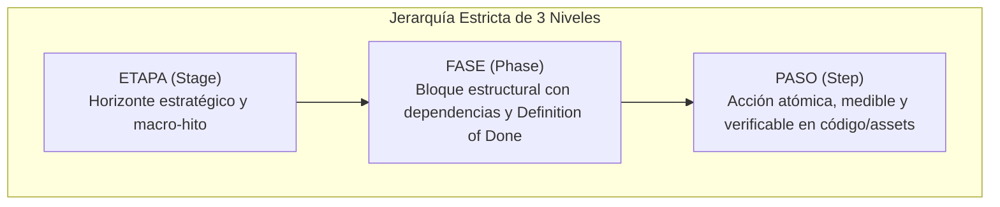
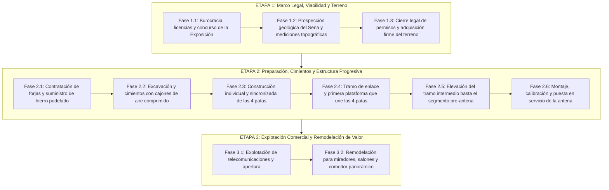

# Estándar de Hojas de Ruta Jerárquicas (Etapa $\to$ Fase $\to$ Paso)

> **Principio Fundamental:** Cero Apresuramiento, Cero Abarcar Todo de Golpe, Cero Roadmap Plano.  
> **Paradigma Rector:** La Construcción Secuencial de la Torre Eiffel (Gustave Eiffel, 1887–1889).

---

## 1. El Problema del Apresuramiento ("Abarcar Todo de Golpe")

Un fallo recurrente en la planificación de agentes autónomos es generar listas de tareas planas y desestructuradas, donde se intenta implementar sistemas avanzados, interfaces finales o características complejas antes de asentar los cimientos técnicos, regulatorios o arquitectónicos del proyecto.

Este comportamiento produce:
1. **Pérdida de foco y dispersión de tokens:** El agente salta entre el modelo de datos, la UI, el backend y el pulido visual sin cerrar ningún hito.
2. **Deuda técnica prematura:** Se construyen subsistemas sobre cimientos inexistentes o inestables, forzando refactorizaciones masivas posteriores.
3. **Imposibilidad de validación empírica:** No existen criterios de salida (*Definition of Done*) para saber si un módulo previo es lo suficientemente sólido para sostener el siguiente nivel.

Para erradicar este antipatrón, toda hoja de ruta generada en este entorno debe seguir una jerarquía estricta de **tres niveles**:



---

## 2. Los Tres Niveles de la Jerarquía

### Nivel 1: ETAPA (Stage / Macro-Hito Estratégico)
- Representa una época o estado completo del ciclo de vida del proyecto.
- Típicamente abarca un cambio mayor de estado (ejemplo: de la concepción/viabilidad a la estructura física, y de la estructura a la operación/mantenimiento).
- Un proyecto promedio suele tener entre **2 y 4 Etapas** en total.
- **Regla:** Ninguna Etapa se inicia sin el cierre formal y validación integral de la Etapa anterior.

### Nivel 2: FASE (Phase / Bloque Estructural)
- Representa un módulo, subsistema o elemento constructivo interdependiente.
- Cada Fase posee:
  1. **Prerrequisitos estrictos:** Qué Fases previas deben estar terminadas y verificadas.
  2. **Objetivo único y delimitado:** Qué problema específico resuelve.
  3. **Definition of Done (DoD):** Pruebas de integración, comprobaciones de rendimiento o evidencia empírica que certifique su finalización.
- **Regla:** Queda prohibido escribir código o generar assets pertenecientes a la Fase $N+1$ si la Fase $N$ no ha satisfecho su DoD.

### Nivel 3: PASO (Step / Tarea Atómica)
- Tareas concretas, individuales y ejecutables (duración típica de minutos a horas).
- Cada Paso debe tener un identificador unívoco (ejemplo: `[E1-F2-P03]`).
- Estados obligatorios: `[ ]` Pendiente, `[/]` En Curso, `[X]` Completado y Verificado.

---

## 3. El Caso de Estudio Rector: El Paradigma de la Torre Eiffel

La construcción de la Torre Eiffel (1887–1889) por Gustave Eiffel y su equipo es el modelo conceptual que debe guiar a todo agente al planificar y ejecutar un proyecto. En ningún momento de los dos años de obra hubo prisa por elevar la antena ni por decorar el restaurante antes de asegurar la geología del suelo y los cimientos de cada pata.



### Desglose Detallado del Paradigma

#### ETAPA 1: Marco Legal, Viabilidad y Adquisición del Terreno
1. **Fase 1.1 (Burocracia y Contratos):**
   - Análisis de pliegos de condiciones de la Exposición Universal de París.
   - Definición de presupuestos, responsabilidades civiles y firma de acuerdos gubernamentales.
2. **Fase 1.2 (Preparación, Medición y Viabilidad del Terreno):**
   - Sondeos geológicos en el Campo de Marte: verificación de la capa freática cercana al río Sena.
   - Cálculo de resistencia de compresión del subsuelo (t/m²).
3. **Fase 1.3 (Cierre Legal y Adquisición):**
   - Formalización notarial y entrega física del terreno.
   - *Criterio de Cierre (Gate E1 $\to$ E2):* No se mueve una sola tonelada de tierra sin títulos de propiedad y estudios geotécnicos certificados.

#### ETAPA 2: Preparativos Industriales, Cimentación y Montaje Estructural
1. **Fase 2.1 (Acuerdos y Logística de Materiales):**
   - Contratación de los talleres de Levallois-Perret para forjado y taladrado de más de 18.000 piezas de hierro pudelado con precisión de 0.1 mm.
2. **Fase 2.2 (Excavación y Cimientos Especiales):**
   - Cimentación de las patas este y sur sobre lecho de grava seco.
   - Cimentación de las patas norte y oeste (próximas al Sena) mediante cajones metálicos herméticos con aire comprimido para expulsar el agua.
3. **Fase 2.3 (Erección de las Cuatro Patas Inclinadas):**
   - Construcción de los 4 pilares en celosía con andamiajes de madera dedicados y gatos hidráulicos para regular el ángulo exacto de inclinación (54° inicial).
   - *Lección crítica:* Cada pata toma meses de trabajo meticuloso e independiente; no se intentó elevarlas de golpe ni forzar el cierre temprano.
4. **Fase 2.4 (Primer Tramo y Unión de las Cuatro Patas):**
   - Colocación de las vigas horizontales que unen las cuatro patas a 57 metros de altura.
   - Calibración milimétrica con cajas de arena y gatos hidráulicos para lograr la coincidencia perfecta de los pernos de unión.
5. **Fase 2.5 (Tramo Intermedio y Segmento Pre-Antena):**
   - Elevación de la torre en una sola flecha piramidal hasta la segunda plataforma (115 m) y la tercera plataforma (276 m).
6. **Fase 2.6 (Montaje y Operación de la Antena / Cúspide):**
   - Instalación del faro luminoso, pararrayos e instrumentación meteorológica/telecomunicaciones funcional.
   - *Criterio de Cierre (Gate E2 $\to$ E3):* Estructura 100% rígida, ensayada y segura.

#### ETAPA 3: Explotación Comercial y Remodelaciones de Ciclo de Vida
1. **Fase 3.1 (Explotación de Telecomunicaciones y Apertura Pública):**
   - Concesión de la antena como laboratorio militar y civil de telegrafía inalámbrica (salvando a la torre de su demolición programada a los 20 años).
2. **Fase 3.2 (Remodelación para Restaurantes y Miradores):**
   - Reacondicionamiento de plataformas intermedias con salones de eventos, restaurantes temáticos y miradores acristalados de alta afluencia.

---

## 4. Reglas Operativas para Agentes de Antigravity

Al crear o actualizar `ROADMAP_DETAILED.md` y `ROADMAP_EXECUTIVE.md`:

1. **Estructura Jerárquica Obligatoria:**
   - Todo archivo de hoja de ruta DEBE organizar las tareas bajo el esquema:
     `Etapa X` $\to$ `Fase X.Y` $\to$ `Paso [EX-FY-PZZ]`.
   - Queda explícitamente prohibido presentar listas planas de tareas `[ ] Tarea 1`, `[ ] Tarea 2`.
2. **Definición de Puertas de Salida (Quality Gates):**
   - Al final de cada Fase debe incluirse un bloque:
     ```markdown
     > **Gate de Cierre de Fase X.Y (DoD):**
     > - [ ] Pruebas unitarias/integración aprobadas sin errores.
     > - [ ] Verificación empírica con scripts o tests automatizados.
     > - [ ] Documentación sincronizada en Docs/.
     ```
3. **Cero Prisa en la Ejecución:**
   - Si una tarea de la Fase 1.2 está pendiente, el agente NUNCA debe ofrecer implementar código de la Fase 2.4.
   - Si el usuario solicita un cambio o módulo adelantado, el agente debe advertir la dependencia pendiente, registrar el atajo temporal en el roadmap y regresar inmediatamente a asegurar los cimientos.
4. **Sincronización con `ROADMAP_EXECUTIVE.md`:**
   - La vista ejecutiva debe reflejar el porcentaje de avance por **Etapa** y por **Fase**, destacando en la caja de enfoque la Fase activa y los Pasos inmediatos que desbloquean el siguiente *Gate*.
