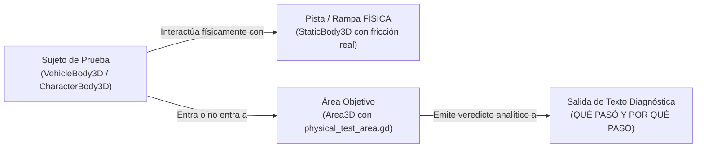

# Protocolo de Validación Física Empírica y Arnés de Pruebas con Area3D

> **Principio Rector:** La física de un videojuego se valida en el motor, no en una pizarra matemática.  
> **Antipatrón Erradicado:** Declarar éxito basándose en cálculos matemáticos estáticos o scripts aislados que ignoran colisiones, fricción, masa, inercia y suspensión.

---

## 1. El Fracaso de los Validadores Puramente Matemáticos

Un error recurrente en el desarrollo de mecánicas de juego consiste en validar controladores o sistemas físicos ejecutando un script de Python o GDScript que únicamente evalúa fórmulas analíticas:
$$\Delta x = v_0 t + \frac{1}{2} a t^2$$

Este enfoque produce **falsos positivos críticos** porque las fórmulas analíticas ignoran:
1. **Discretización del Integrador Físico:** En Godot (física a 60 Hz), el paso de tiempo variable o discretizado induce fluctuaciones cinemáticas reales.
2. **Fricción de Contacto y Normales de Colisión:** El comportamiento dinámico de neumáticos (`VehicleWheel3D`) o cápsulas de personaje (`CharacterBody3D`) depende del coeficiente de fricción de la superficie, la pendiente y los ángulos de impacto.
3. **Suspensión, Inercia y Centro de Masas:** Un cálculo matemático puede decir que un vehículo alcanza 60 km/h en 3 segundos, pero en el motor el vehículo vuelca en la primera curva porque el centro de masa está elevado, o las ruedas patinan sin tracción por falta de carga normal.
4. **Pérdida de Adherencia (Slip Ratio):** Una simulación de tracción en pendientes o barro no se comporta como un modelo rectilíneo ideal.

**Regla de Oro:** Ninguna mecánica cinemática o física se da por aprobada sin haber sido ejecutada y medida empíricamente en una **Escena de Test Mínimo Físico**.

---

## 2. El Protocolo de Propuesta Colaborativa (Agente $\to$ Usuario)

Cuando el agente diseñe, ajuste o corrija una mecánica física (ejemplo: tracción de vehículo, suspensión, salto, balística o grappling hook), el agente **NO debe intentar validar mediante fórmulas abstractas en consola**.

En su lugar, el agente DEBE emitir una **propuesta explícita al usuario**:

```markdown
> 🎯 **Propuesta de Validación Física Empírica:**
> Para comprobar el comportamiento real del vehículo (fricción, masa y estabilidad) en el motor de físicas de Godot:
> 1. Propongo crear/usar la Escena de Test Físico Mínimo: `res://tests/physical/test_vehiculo_aceleracion.tscn`.
> 2. Geometría de prueba: Pista plana de 50 metros con material de fricción estándar ($\mu = 0.8$) y zona objetivo con `Area3D`.
> 3. Criterios de Aceptación (Condición de Validez):
>    - Llegar al `Area3D` en un tiempo $t \le 4.5\text{ s}$.
>    - Velocidad al entrar: $v \in [12.0, 16.0]\text{ m/s}$.
>    - Estabilidad: Inclinación lateral $|\text{roll}| < 25^\circ$ (sin vuelco).
> 4. La escena registrará automáticamente en consola **QUÉ PASÓ Y POR QUÉ PASÓ**.
> ¿Procedemos con la creación/ejecución de esta escena de prueba?
```

Esta propuesta establece un contrato claro y verificable entre el agente y el usuario, eliminando discusiones ambiguas.

---

## 3. Arquitectura de la Escena de Test Mínimo con `Area3D`

La escena de prueba física debe ser mínima, sin elementos cosméticos que consuman recursos, enfocada exclusivamente en la interacción mecánica:

```
TestArena (Node3D) [test_arena.gd]
├── DirectionalLight3D / WorldEnvironment
├── Pista (StaticBody3D)
│   ├── MeshInstance3D (BoxMesh / RampMesh)
│   └── CollisionShape3D (BoxShape3D) [PhysicsMaterial: friction = 0.8]
├── Sujeto (VehicleBody3D / CharacterBody3D)
│   └── ... ruedas, colisión, script del controlador ...
└── SensorMeta (Area3D) [physical_test_area.gd]
    └── CollisionShape3D (BoxShape3D)
```



---

## 4. Requisitos de la Salida de Texto Diagnóstica ("Qué pasó y Por qué pasó")

El script del sensor `Area3D` (o el supervisor de la arena) DEBE registrar salidas de texto estructuradas que expliquen la causa física del resultado:

### Caso 1: Éxito
```text
[TEST-FISICO:EXITO]
- Evento: Sujeto 'VehicleBody3D' ingresó a 'SensorMeta'.
- Qué pasó: Completó el recorrido de 40m en 3.42s (límite máximo: 5.00s).
- Telemetría: Velocidad = 13.8 m/s, Roll = 2.1°, Pitch = 0.8°.
- Por qué pasó: Las 4 ruedas mantuvieron adherencia constante (slip < 0.15) con fuerza de tracción efectiva de 1800 N.
```

### Caso 2: Fallo por Pérdida de Tracción / Potencia Insuficiente
```text
[TEST-FISICO:FALLO]
- Evento: Timeout alcanzado (5.00s transcurridos sin alcanzar SensorMeta).
- Qué pasó: El vehículo se detuvo en la posición X=18.4m (recorrido 46%).
- Telemetría: Velocidad final = 0.2 m/s, Deslizamiento de rueda trasera = 0.92 (patinamiento extremo).
- Por qué pasó: El par motor aplicado (2500 Nm) superó el límite de fricción estática del neumático en la rampa de 15°, provocando pérdida total de agarre.
- Recomendación física: Reducir curva de aceleración inicial o aumentar carga sobre el eje motriz.
```

### Caso 3: Fallo por Vuelco / Inestabilidad Dinámica
```text
[TEST-FISICO:FALLO]
- Evento: Vuelco dinámico detectado a t=2.15s.
- Qué pasó: El vehículo volcó lateralmente antes de llegar a SensorMeta.
- Telemetría: Roll máximo = 78.4° (límite de seguridad: 30°), Velocidad en vuelco = 11.2 m/s.
- Por qué pasó: Transferencia de peso lateral excesiva debida a un centro de gravedad excesivamente alto (Y = 1.15m) combinado con suspensión delantera demasiado blanda.
- Recomendación física: Bajar el centro de masa a Y <= 0.45m o endurecer la barra estabilizadora.
```

---

## 5. Plantilla GDScript Reutilizable: `physical_test_area.gd`

```gdscript
extends Area3D
class_name PhysicalTestArea

@export var test_name: String = "Test de Desplazamiento Físico"
@export var timeout_seconds: float = 6.0
@export var min_entry_speed: float = 10.0
@export var max_entry_speed: float = 20.0
@export var max_allowed_roll_deg: float = 30.0
@export var auto_quit_on_finish: bool = false

var _elapsed_time: float = 0.0
var _test_finished: bool = false
var _target_body: Node3D = null

func _ready() -> void:
	body_entered.connect(_on_body_entered)
	print("[TEST-FISICO:INICIO] '%s' armado. Esperando sujeto (Timeout: %.1fs)..." % [test_name, timeout_seconds])

func _physics_process(delta: float) -> void:
	if _test_finished:
		return
		
	_elapsed_time += delta
	
	# Verificar vuelco del sujeto si está en escena
	if _target_body and is_instance_valid(_target_body):
		var roll = abs(rad_to_deg(_target_body.rotation.z))
		if roll > max_allowed_roll_deg:
			_fail_test("Vuelco lateral detectado", "Roll de %.1f° superó el límite permitido de %.1f°" % [roll, max_allowed_roll_deg])
			return

	if _elapsed_time >= timeout_seconds:
		_fail_test("Tiempo límite agotado (Timeout)", "El sujeto no alcanzó el Area3D en %.2fs. Posible falta de tracción, potencia o bloqueo físico." % timeout_seconds)

func register_subject(body: Node3D) -> void:
	_target_body = body

func _on_body_entered(body: Node3D) -> void:
	if _test_finished:
		return
		
	if _target_body != null and body != _target_body:
		return  # Ignorar otros cuerpos

	var speed = 0.0
	var roll = 0.0
	if body is RigidBody3D:
		speed = body.linear_velocity.length()
		roll = abs(rad_to_deg(body.rotation.z))
	elif body is CharacterBody3D:
		speed = body.velocity.length()
		roll = abs(rad_to_deg(body.rotation.z))

	# Validar condiciones de éxito
	if speed < min_entry_speed:
		_fail_test("Velocidad de entrada insuficiente", "Velocidad registrada: %.2f m/s (Mínimo requerido: %.2f m/s)." % [speed, min_entry_speed])
		return
		
	if speed > max_entry_speed:
		_fail_test("Velocidad de entrada excesiva", "Velocidad registrada: %.2f m/s (Máximo permitido: %.2f m/s)." % [speed, max_entry_speed])
		return

	_pass_test(speed, roll)

func _pass_test(speed: float, roll: float) -> void:
	_test_finished = true
	print("\n=======================================================")
	print("[TEST-FISICO:EXITO] %s" % test_name)
	print("- Qué pasó: El sujeto alcanzó el Area3D en %.2fs." % _elapsed_time)
	print("- Telemetría: Velocidad = %.2f m/s, Inclinación Roll = %.1f°." % [speed, roll])
	print("- Por qué pasó: Parámetros de masa, tracción y suspensión dentro del rango dinámico esperado.")
	print("=======================================================\n")
	_finish(0)

func _fail_test(motivo: String, explicacion_fisica: String) -> void:
	_test_finished = true
	printerr("\n=======================================================")
	printerr("[TEST-FISICO:FALLO] %s" % test_name)
	printerr("- Qué pasó: %s." % motivo)
	printerr("- Por qué pasó: %s" % explicacion_fisica)
	printerr("- Tiempo registrado: %.2fs." % _elapsed_time)
	printerr("=======================================================\n")
	_finish(1)

func _finish(exit_code: int) -> void:
	if auto_quit_on_finish and OS.has_feature("dedicated_server") or DisplayServer.get_name() == "headless":
		get_tree().quit(exit_code)
```

---

## 6. Integración con el Flujo de Trabajo del Agente

1. **Fase de Diseño:** El agente extrae las especificaciones cinemáticas del juego original o requerimiento.
2. **Propuesta al Usuario:** El agente propone la escena de prueba mínima con `Area3D` y criterios de validez cuantitativos.
3. **Ejecución en Motor:** El agente ejecuta la prueba con Godot (mediante `project_run` de `godot-ai` o `godot --headless res://tests/physical/test_*.tscn`).
4. **Análisis de Evidencia:** El agente lee la salida diagnóstica ("Qué pasó y Por qué pasó") y sólo declara la tarea completada si la física real arrojó `[TEST-FISICO:EXITO]`.
