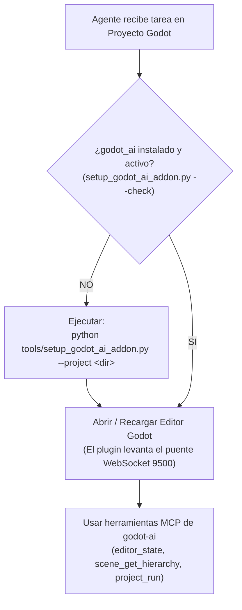

# Aprovisionamiento Automatizado del Addon Godot AI y Conexión MCP

> **Regla de Oro:** Ningún agente debe operar sobre un proyecto de Godot sin verificar previamente que el addon `godot_ai` esté instalado y habilitado en `project.godot`.  
> **Herramienta Automatizada:** `tools/setup_godot_ai_addon.py` (Aprovisionamiento en Un Solo Disparo).

---

## 1. El Problema de la Omisión del Addon

Un fallo recurrente observado en los agentes es que, al interactuar con proyectos de Godot, **evitan instalar y preparar el addon necesario para el servidor MCP `godot-ai`**.

Este comportamiento provoca:
1. **Fallo de Conexión Silencioso:** El agente intenta usar herramientas MCP como `editor_state`, `node_create` o `project_run`, pero al no estar el plugin activo en el editor, la conexión WebSocket (puerto 9500) o HTTP (puerto 8000) falla o no responde.
2. **Evasión de Capacidades ("Agent Avoidance"):** Ante el fallo, el agente evita usar `godot-ai`, deja de probar los cambios en el editor en vivo, y vuelve a la edición manual ciega de archivos de texto o formula preguntas innecesarias al usuario.
3. **Proyectos Incompletos:** Proyectos nuevos creados desde cero carecen de la infraestructura para depuración en vivo.

---

## 2. Los Dos Requisitos Obligatorios del Motor

Para que el servidor MCP `godot-ai` pueda controlar el editor en caliente, el proyecto Godot DEBE tener configurados dos elementos:

```
MiProyectoGodot/
├── addons/
│   └── godot_ai/               <-- 1. Carpeta completa del plugin copiada desde templates
│       ├── plugin.cfg
│       ├── plugin.gd
│       └── runtime/
│           └── game_helper.gd
└── project.godot               <-- 2. Configurado con editor_plugins y autoload
```

### En `project.godot`:
```ini
[editor_plugins]

enabled=PackedStringArray("res://addons/godot_ai/plugin.cfg")

[autoload]

_mcp_game_helper="*res://addons/godot_ai/runtime/game_helper.gd"
```

---

## 3. Protocolo de Aprovisionamiento en Un Solo Disparo

Queda terminantemente prohibido que los agentes intenten copiar manualmente decenas de archivos o editar a ciegas `project.godot`. En su lugar, deben ejecutar el script automatizado:

```bash
# 1. Comprobar si el proyecto ya está listo
python tools/setup_godot_ai_addon.py --project "C:\Ruta\Al\Proyecto" --check

# 2. Instalar y configurar automáticamente en un solo paso
python tools/setup_godot_ai_addon.py --project "C:\Ruta\Al\Proyecto"
```

### Lo que hace el script en un solo comando:
1. Copia la plantilla verificada del addon desde `templates/addons/godot_ai/` a `<project>/addons/godot_ai/`.
2. Inspecciona sintácticamente `project.godot`.
3. Registra `"res://addons/godot_ai/plugin.cfg"` en `enabled=PackedStringArray(...)` sin alterar los plugins ya existentes.
4. Registra el autoload `_mcp_game_helper` sin alterar los autoloads existentes.
5. Verifica la integridad y retorna código de salida `0` confirmando que el entorno está listo para la conexión MCP.

---

## 4. Flujo Obligatorio para Agentes de Godot

Antes de emprender cualquier tarea de desarrollo, refactorización o corrección en un proyecto de Godot:


