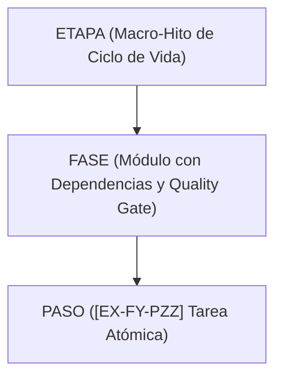

# Dual-Track Roadmap: Hojas de Ruta Técnica y Ejecutiva

Consulta la guía arquitectónica completa y el caso de estudio en:
- [Docs/architecture/hierarchical_roadmap_standard.md](file:///c:/Users/cesar/Desktop/skill/Docs/architecture/hierarchical_roadmap_standard.md)

Esta skill establece la metodología para generar y mantener **dos hojas de ruta complementarias e interconectadas**, bajo el principio de **cero apresuramiento y jerarquía estricta**:

1. **Hoja de Ruta Exhaustiva y Viva (`ROADMAP_DETAILED.md`)**: Registro técnico milimétrico, granular y continuo en 3 niveles (`Etapa` $\to$ `Fase` $\to$ `Paso`).
2. **Hoja de Ruta Resumida y Visual (`ROADMAP_EXECUTIVE.md`)**: Cuadro de mando ejecutivo, vistoso y directo (máximo 1 pantalla) para seguimiento del usuario.

---

## 1. El Paradigma Rector: La Construcción de la Torre Eiffel

> **Regla de Oro:** Prohibido "abarcar todo de golpe" o acelerar la construcción de la cúspide antes de asegurar el terreno y los cimientos.

Al igual que en la construcción de la Torre Eiffel (1887–1889):
- **Etapa 1 (Marco Legal y Terreno):** Fase 1.1 Permisos y burocracia $\to$ Fase 1.2 Prospección geológica y medición del Sena $\to$ Fase 1.3 Cierre legal y compra del terreno.
- **Etapa 2 (Estructura y Cimientos):** Fase 2.1 Forja y logística $\to$ Fase 2.2 Excavación y cimientos con cajones herméticos $\to$ Fase 2.3 Erección minuciosa de las 4 patas independientes $\to$ Fase 2.4 Primer tramo de unión $\to$ Fase 2.5 Tramo intermedio y pre-antena $\to$ Fase 2.6 Antena funcional.
- **Etapa 3 (Explotación y Remodelación):** Fase 3.1 Servicios de telecomunicaciones $\to$ Fase 3.2 Remodelación para miradores, salones y restaurante panorámico.

---

## 2. Jerarquía Estricta de 3 Niveles

Toda hoja de ruta debe estructurarse obligatoriamente en:

1. **ETAPA (Stage):** Macro-hito del ciclo de vida del proyecto (1 a 4 por proyecto).
2. **FASE (Phase):** Bloque modular interdependiente. Cuenta con prerrequisitos y una puerta de salida (*Quality Gate / Definition of Done*).
3. **PASO (Step):** Tarea atómica y verificable con ID jerárquico unívoco (`[E1-F2-P03]`).



---

## 3. Artefacto 1: Hoja de Ruta Exhaustiva (`ROADMAP_DETAILED.md`)

Fuente de la verdad técnica operativa. Ningún detalle de ingeniería o arquitectura se omite.

### Reglas Obligatorias:
- **Estructura Jerárquica WBS:**
  ```markdown
  ### ETAPA 1: Cimientos y Arquitectura Base
  #### Fase 1.1: Configuración de Entorno y Protocolos
  - [X] [E1-F1-P01] Crear estructura de carpetas y Docs/
  - [ ] [E1-F1-P02] Configurar herramientas y dependencias
  
  > **Gate de Cierre de Fase 1.1 (DoD):**
  > - [ ] Tests iniciales aprobados sin advertencias.
  ```
- **Estados de Tarea:**
  - `[ ]` **Pendiente:** Planificada pero no iniciada.
  - `[/]` **En Progreso:** Trabajo activo en la sesión actual.
  - `[X]` **Completada:** Terminada y verificada con pruebas o evidencia.
  - `[-]` **Descartada / Postergada:** Explicada en la bitácora con motivo.
- **Campos por Tarea Crítica:** Dependencias directas, archivos tocados y criterio de aceptación (DoD).
- **Bitácora de Deuda Técnica y Atajos:** Registro explícito para no perder momentum sin olvidar compromisos.

---

## 4. Artefacto 2: Hoja de Ruta Resumida (`ROADMAP_EXECUTIVE.md`)

Diseñado para ser **leído en menos de 60 segundos** por el usuario.

### Reglas Obligatorias:
- **Cero Micro-Gestión:** Prohibido listar tareas internas de 5 minutos.
- **Barra de Progreso por Etapa y Fase:**
  ```text
  ETAPA 1: Terreno y Cimientos [██████████] 100% (Completada)
    ├─ Fase 1.1: Permisos y Viabilidad [██████████] 100%
    └─ Fase 1.2: Excavación y Cimiento [██████████] 100%
  ETAPA 2: Estructura Progresiva [██████░░░░]  60% (En curso)
    ├─ Fase 2.1: Cuatro Patas Base    [██████████] 100%
    ├─ Fase 2.2: Plataforma de Unión  [████████░░]  80%
    └─ Fase 2.3: Tramo Pre-Antena     [░░░░░░░░░░]   0%
  Progreso Total                     [████████░░]  78%
  ```
- **Semáforo de Salud:** 🟢 Saludable / 🟡 Atención / 🔴 Bloqueado.
- **Caja de Enfoque Actual:** 1 párrafo claro que explica exactamente qué Fase y Pasos se están atacando hoy.
- **Top 3 Próximos Pasos:** Las 3 prioridades inmediatas que desbloquean el siguiente *Quality Gate*.

---

## 5. Protocolo de Ejecución y Mantenimiento

1. **Descubrimiento y Partición (No Rushing):** Descomponer el proyecto en Etapas y Fases antes de escribir código.
2. **Crear `ROADMAP_DETAILED.md`** con IDs `[EX-FY-PZZ]` y Gates de Fase.
3. **Sintetizar `ROADMAP_EXECUTIVE.md`** reflejando barras y semáforo.
4. **Al completar una tarea:**
   - Actualizar `[X]` en el detallado.
   - Verificar si se completó el Gate de la Fase.
   - Refrescar la barra y el foco en el ejecutivo.
